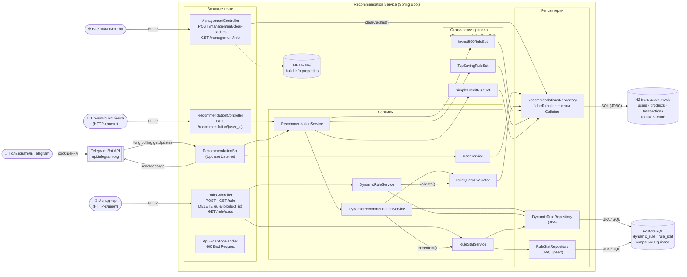
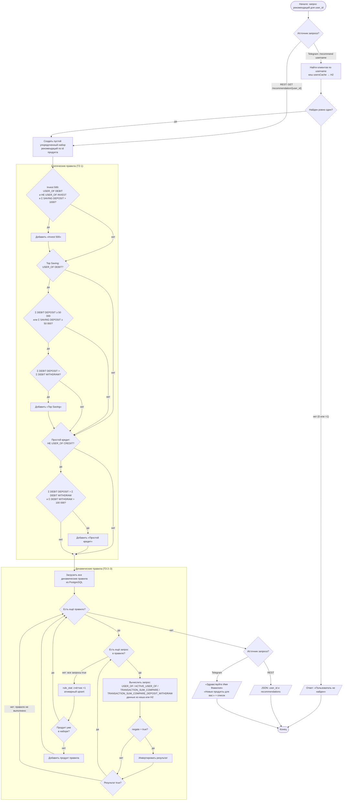
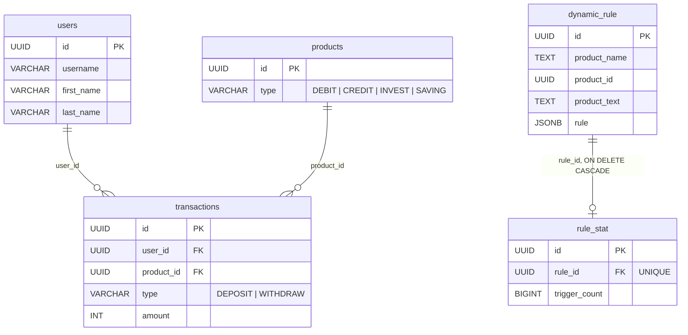

# Архитектура приложения

Монолитное Spring Boot приложение с классическим разделением на слои:
**контроллеры / бот → сервисы → правила → репозитории → базы данных**.

## Диаграмма компонентов

Стрелки показывают направление вызовов. Слева — источники внешних вызовов, справа — внешние системы,
к которым обращается приложение.

### Компоненты

| Компонент                          | Назначение                                                                                                                                         |
|------------------------------------|----------------------------------------------------------------------------------------------------------------------------------------------------|
| `RecommendationController`         | REST-вход для получения рекомендаций.                                                                                                              |
| `RuleController`                   | REST API менеджера: CRUD динамических правил и статистика.                                                                                          |
| `ManagementController`             | Служебный API для внешних систем: сброс кешей, имя и версия сборки (из `build-info.properties`, генерируется `spring-boot-maven-plugin`).          |
| `RecommendationBot`                | Telegram-бот: получает сообщения long polling'ом через `java-telegram-bot-api`, отвечает рекомендациями.                                            |
| `ApiExceptionHandler`              | Превращает `IllegalArgumentException` в `400 {"error": "..."}`.                                                                                    |
| `RecommendationService`            | Точка сборки рекомендаций: вызывает все статические правила, затем динамические, убирает дубликаты по `id` продукта.                             |
| `RecommendationRuleSet` и реализации | Статические правила из ТЗ 1, зашитые в код. Spring внедряет все реализации списком, поэтому новое правило = новый `@Component`.                   |
| `DynamicRecommendationService`     | Перебирает динамические правила, вычисляет их и увеличивает счётчик сработавших.                                                                    |
| `RuleQueryEvaluator`               | Валидирует и вычисляет запросы `USER_OF`, `ACTIVE_USER_OF`, `TRANSACTION_SUM_COMPARE`, `TRANSACTION_SUM_COMPARE_DEPOSIT_WITHDRAW`.               |
| `DynamicRuleService`               | Создание (с валидацией), чтение и удаление динамических правил.                                                                                   |
| `RuleStatService`                  | Атомарное увеличение счётчика и выдача статистики по всем правилам.                                                                                 |
| `UserService`                      | Поиск клиента по `username` для бота (только единственное совпадение).                                                                              |
| `RecommendationsRepository`        | Единственное место с SQL к H2. Три кеша Caffeine: число транзакций, суммы, пользователи по `username`.                                             |
| `DataSourceConfiguration`          | Два `DataSource`: H2 (`@Primary`, для `JdbcTemplate`) и PostgreSQL (для JPA и Liquibase), отдельный `rulesTransactionManager`.                    |

## Диаграмма деятельности: выдача рекомендаций

Алгоритм `RecommendationService.getRecommendations(userId)`, общий для REST API и Telegram-бота.

### Ключевые решения

* **Дедупликация.** Рекомендации собираются в `LinkedHashMap` по `id` продукта: сначала статические, затем динамические.
  Если продукт есть и там и там, в ответе остаётся первая (статическая) рекомендация.
* **Счётчик статистики** увеличивается для каждого выполненного динамического правила, даже если его продукт уже был
  в ответе: статистика отражает срабатывание правила, а не показ продукта.
* **Кеширование.** Все обращения к H2 идут через `RecommendationsRepository`, который кеширует результаты по ключу
  `(userId, productType[, transactionType])`. Внешняя система сбрасывает кеш через `POST /management/clear-caches`
  после обновления данных в H2.
* **Ленивое вычисление.** Статические правила сначала проверяют самое дешёвое условие; динамическое правило перестаёт
  вычисляться на первом ложном запросе (`allMatch`).

## Модель данных

Таблицы `users`, `products`, `transactions` находятся в H2 (только чтение), `dynamic_rule` и `rule_stat` — в PostgreSQL.

## Как добавить новую функциональность

**Новое статическое правило.** Создать класс в пакете `rules`, реализующий `RecommendationRuleSet`, и пометить его
`@Component`. Данные брать только через `RecommendationsRepository`, чтобы работал кеш. `RecommendationService`
подхватит правило автоматически.

**Новый тип запроса для динамических правил** (например, `TRANSACTION_COUNT_COMPARE`):

1. Если нужен новый SQL, добавить метод с собственным кешем в `RecommendationsRepository` и очистку этого кеша в `clearCaches()`.
2. Добавить ветку в `RuleQueryEvaluator.validate()` с проверкой числа и значений аргументов.
3. Добавить ветку в `RuleQueryEvaluator.evaluate()`.
4. Добавить тесты в `RuleQueryEvaluatorTest` и описать запрос на страницах [Требования](Requirements) и [REST API](REST-API).

Схема БД при этом не меняется: запросы хранятся в JSONB-колонке `dynamic_rule.rule`.
