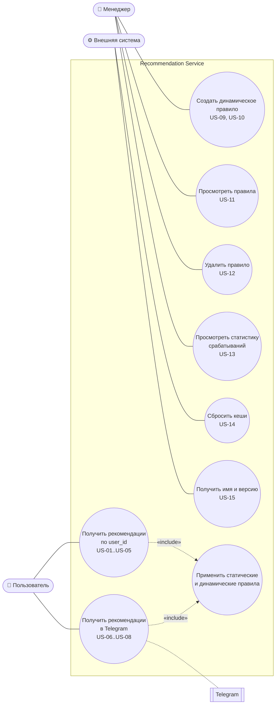

# Требования

Требования собраны из трёх технических заданий и записаны в формате User Story.
Идентификаторы используются в [таблице статуса реализации](Traceability), в Issues и в описаниях Pull Request.

## Акторы

| Актор                | Описание                                                                                          |
|----------------------|---------------------------------------------------------------------------------------------------|
| **Менеджер**         | Сотрудник банка: управляет динамическими правилами и смотрит статистику их срабатываний.          |
| **Пользователь**     | Клиент банка: получает рекомендации через REST API (через приложения банка) и через Telegram-бота. |
| **Внешняя система**  | Сервис мониторинга и администрирования: сбрасывает кеши и запрашивает информацию о сервисе.       |

## User Stories

### Пользователь (клиент банка)

| ID     | User Story                                                                                                                                                                                         | Критерии приёмки                                                                                                                                                   | ТЗ |
|--------|----------------------------------------------------------------------------------------------------------------------------------------------------------------------------------------------------|--------------------------------------------------------------------------------------------------------------------------------------------------------------------|----|
| US-01  | Как **пользователь**, я хочу получать список рекомендованных мне продуктов по своему идентификатору, чтобы узнавать о подходящих предложениях банка.                                               | `GET /recommendation/{user_id}` возвращает `{"user_id", "recommendations": [{"name","id","text"}]}`; если подходящих продуктов нет, список пустой.                  | 1  |
| US-02  | Как **пользователь**, я хочу получать рекомендацию «Invest 500», если пользуюсь дебетовым продуктом, не пользуюсь инвестиционными и пополнил сберегательные продукты больше чем на 1000 ₽.         | Все три условия выполнены: продукт в ответе; хотя бы одно не выполнено: продукта нет.                                                                              | 1  |
| US-03  | Как **пользователь**, я хочу получать рекомендацию «Top Saving», если пользуюсь дебетовым продуктом, пополнил DEBIT или SAVING не меньше чем на 50 000 ₽ и пополнений по DEBIT больше, чем трат. | Аналогично US-02.                                                                                                                                                  | 1  |
| US-04  | Как **пользователь**, я хочу получать рекомендацию «Простой кредит», если у меня нет кредитов, пополнений по DEBIT больше, чем трат, и траты по DEBIT больше 100 000 ₽.                            | Аналогично US-02.                                                                                                                                                  | 1  |
| US-05  | Как **пользователь**, я хочу получать рекомендации и по динамическим правилам, которые настроил менеджер, чтобы видеть актуальные предложения без релиза сервиса.                                  | В ответ `GET /recommendation/{user_id}` попадают продукты сработавших динамических правил; один продукт встречается в ответе не больше одного раза.                 | 2  |
| US-06  | Как **пользователь**, я хочу запросить рекомендации в Telegram командой `/recommend username`, чтобы получать их в мессенджере.                                                                    | Ответ: «Здравствуйте <имя> <фамилия>», «Новые продукты для вас:» и список названий продуктов.                                                                      | 3  |
| US-07  | Как **пользователь**, я хочу получить сообщение «Пользователь не найден», если имя пользователя не найдено или неоднозначно, чтобы понимать, что запрос не выполнен.                             | Ноль или несколько клиентов с таким `username` дают ответ «Пользователь не найден».                                                                                | 3  |
| US-08  | Как **пользователь**, я хочу при первом обращении к боту увидеть приветствие и справку, чтобы понять, как им пользоваться.                                                                         | На `/start` и любое нераспознанное сообщение бот отвечает приветствием и описанием команды `/recommend`.                                                           | 3  |

### Менеджер

| ID     | User Story                                                                                                                                                         | Критерии приёмки                                                                                                                                                                                | ТЗ |
|--------|--------------------------------------------------------------------------------------------------------------------------------------------------------------------|-------------------------------------------------------------------------------------------------------------------------------------------------------------------------------------------------|----|
| US-09  | Как **менеджер**, я хочу создавать динамическое правило рекомендации для продукта, чтобы запускать новые предложения без участия разработчиков.                   | `POST /rule` с `product_name`, `product_id`, `product_text`, `rule` сохраняет правило и возвращает его с выданным `id`.                                                                          | 2  |
| US-10  | Как **менеджер**, я хочу собирать правило из запросов `USER_OF`, `ACTIVE_USER_OF`, `TRANSACTION_SUM_COMPARE`, `TRANSACTION_SUM_COMPARE_DEPOSIT_WITHDRAW` с флагом `negate`, чтобы описывать условия любой сложности. | Правило срабатывает, когда все запросы истинны; `negate: true` инвертирует результат запроса; некорректный запрос отклоняется с `400` и описанием ошибки.                                       | 2  |
| US-11  | Как **менеджер**, я хочу просматривать все динамические правила, чтобы контролировать текущую конфигурацию.                                                        | `GET /rule` возвращает `{"data": [...]}`.                                                                                                                                                       | 2  |
| US-12  | Как **менеджер**, я хочу удалять правило продукта, чтобы прекращать неактуальные предложения.                                                                       | `DELETE /rule/{product_id}` возвращает `204 No Content`; статистика правила удаляется вместе с ним.                                                                                            | 2  |
| US-13  | Как **менеджер**, я хочу видеть, сколько раз сработало каждое динамическое правило, чтобы оценивать его эффективность.                                              | `GET /rule/stats` возвращает `{"stats": [{"rule_id", "count"}]}` по всем существующим правилам; правило без срабатываний имеет `count = 0`.                                                     | 3  |

### Внешняя система

| ID     | User Story                                                                                                                                       | Критерии приёмки                                                                                     | ТЗ |
|--------|--------------------------------------------------------------------------------------------------------------------------------------------------|------------------------------------------------------------------------------------------------------|----|
| US-14  | Как **внешняя система**, я хочу сбрасывать кеши сервиса после обновления данных в основной БД, чтобы рекомендации строились по свежим данным.   | `POST /management/clear-caches` без тела очищает все кеши и возвращает `200 OK`.                    | 3  |
| US-15  | Как **внешняя система**, я хочу получать название и версию сервиса, чтобы проверять, какая сборка развернута.                                   | `GET /management/info` возвращает `{"name": "<artifactId>", "version": "<version из pom.xml>"}`.     | 3  |

## Нефункциональные требования

| ID      | Категория                | Требование                                                                                                                                                                          |
|---------|--------------------------|-------------------------------------------------------------------------------------------------------------------------------------------------------------------------------------|
| NFR-01  | Производительность       | Результаты запросов к основной БД кешируются (Caffeine, до 10 000 записей на кеш). Повторный запрос рекомендаций для того же клиента не выполняет SQL к H2.                         |
| NFR-02  | Безопасность данных      | Основная БД с транзакциями используется только для чтения (`spring.datasource.hikari.read-only=true`); сервис не изменяет данные клиентов.                                         |
| NFR-03  | Хранение данных          | Динамические правила и статистика хранятся в отдельной БД PostgreSQL; схема создаётся и версионируется только миграциями Liquibase (`ddl-auto=none`).                              |
| NFR-04  | Логирование ошибок       | Ошибки обработки сообщений Telegram логируются на уровне `ERROR` и не останавливают бота; неудачная отправка сообщения логируется с кодом ошибки Telegram.                         |
| NFR-05  | Надёжность               | Сервис запускается и обслуживает REST API без токена Telegram и без доступа к Telegram; в этом случае бот отключается с предупреждением в логе.                                    |
| NFR-06  | Корректность входных данных | Некорректные данные (неизвестный тип запроса, неверное число аргументов, отрицательная константа, невалидный UUID) отклоняются ответом `400 Bad Request` с описанием ошибки.     |
| NFR-07  | Согласованность данных   | Счётчик срабатываний правила увеличивается атомарно одним SQL-запросом (upsert), одновременные запросы не теряют срабатывания.                                                     |
| NFR-08  | Документирование         | REST API описан в формате OpenAPI 3 и доступен в Swagger UI (`/swagger-ui.html`); публичные классы и методы имеют Javadoc.                                                         |
| NFR-09  | Конфигурируемость        | Адреса и учётные данные БД и токен бота задаются переменными окружения без пересборки; секреты не хранятся в репозитории.                                                         |
| NFR-10  | Сопровождаемость         | Код отформатирован по стандарту IntelliJ IDEA, без закомментированного кода; бизнес-логика правил покрыта модульными тестами (`./mvnw test`).                                      |

## Диаграмма вариантов использования

